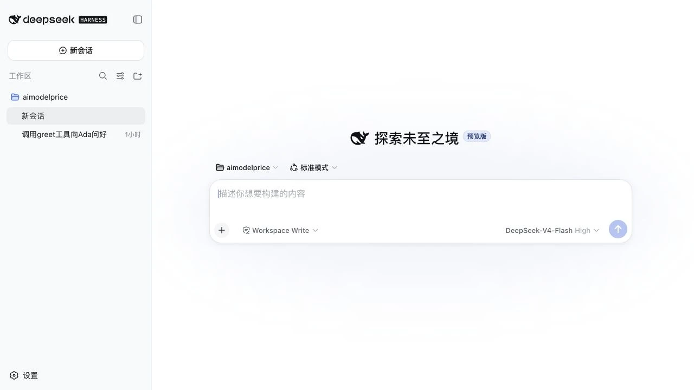
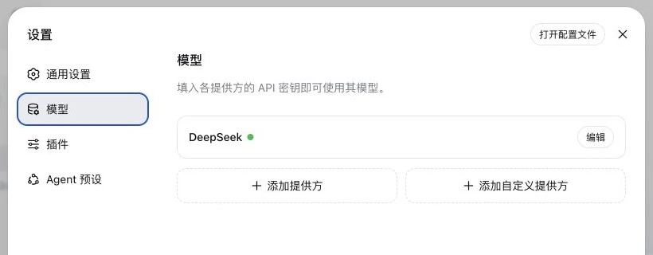
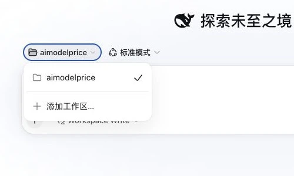
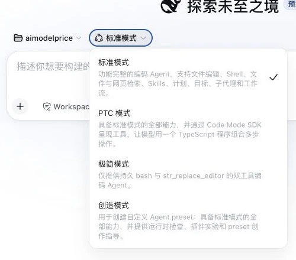
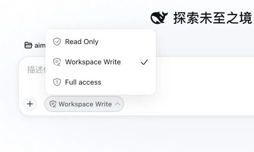
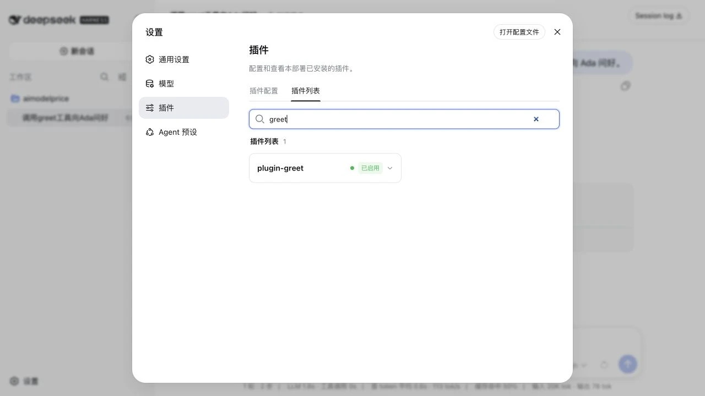
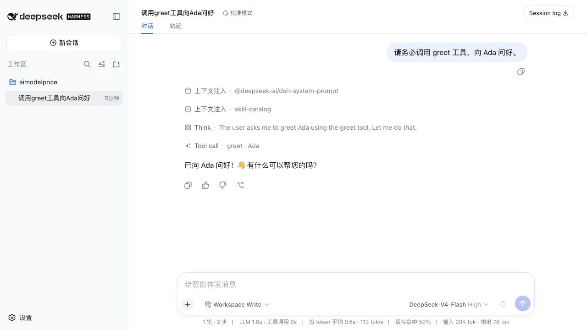
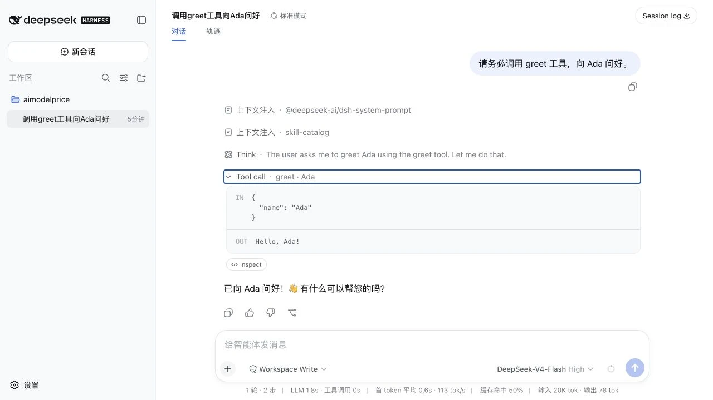

* 目录
{:toc}

这篇文章带你走完一次完整实操：用 npm 启动 DeepSeek Harness，亲手制作一个 greet 插件，把它添加到 web Profile，最后在聊天窗口里让模型调用它。

**看完你能获得什么**

先把 DeepSeek Harness 的 Web 页面跑起来，弄懂工作区、新会话、Agent 预设和访问权限，知道第一次应该怎么选。再创建 package.json、cordis.patch.yml 和 index.js，理解一个最小工具插件分别需要哪些内容。最后安装并使用 greet，看到模型生成参数、执行工具和返回结果；遇到问题时也知道从哪里检查。

我今天第一次把 DeepSeek Harness 下载到本地，用一条 npm 命令打开了 Web 页面。随后，我照着它的插件机制写了一个只会问好的小工具。

最后的效果很直观。我在聊天窗口输入“请务必调用 greet 工具，向 Ada 问好”，页面出现 `greet · Ada`，工具收到 `{"name":"Ada"}`，再返回 `Hello, Ada!`。

看到这两行时，我还是挺开心的。以前读到 Tool Call、JSON Schema 和插件运行时，脑子里只有概念；这次是我自己的代码被模型选中、执行，再把结果写回会话。

前段时间，我转发过 DeepSeek Harness 的消息，也记住了它那句 **Everything is a Plugin，一切皆插件**。今天终于可以用一个小插件亲手验证这句话。下面就从启动开始，一步一步做。

先说明版本边界：DeepSeek Harness 来自 DeepSeek AI 官方开源仓库，目前处于 Developer Preview。本文适合学习和试用；后续版本可能调整插件接口，正式项目升级前需要重新核对文档。

## 01 用一条命令启动 DeepSeek Harness

官方提供了 npm 启动方式。电脑里安装好 Node.js 后，打开终端，执行：

```sh
npx @deepseek-ai/dsh web
```

第一次运行时，npx 会下载当前版本并初始化 web Profile。终端出现启动信息后，在浏览器打开：

```text
http://127.0.0.1:3080
```

如果遇到 Node 版本提示，可以换到 Node.js 24。当前项目源码声明支持 Node 22.19.x 或 24 及以上版本。刚接触 Node 的读者，用 Node 24 会省掉一些版本判断。

我这次使用的是 npm 的最短启动路径，适合先体验产品。准备阅读源码或参与开发时，也可以从 GitHub 克隆仓库，再执行 pnpm install、pnpm run build 和 pnpm dsh web。两种方式打开的是同一套 Web UI，第一次试用直接用 npm 更省事。

看到下面这个页面，就说明 Web 服务已经启动成功。第一次打开先别急着发消息，输入框周围的四个选择需要认识一下：工作区、Agent 模式、访问权限和模型。

[](/assets/img/wechat-archive/deepseek-harness-plugin-guide/260814-dsh-05-new-session.webp)

图 1：新会话页面，发送任务前先确认四个选择

**工作区**：Agent 这次围绕哪个本地文件夹工作。**Agent 模式**：给这个会话装配哪些工具、提示词和工作能力。**访问权限**：Agent 可以只读文件、写工作区，还是拥有更大的文件访问范围。**模型**：由哪个大模型理解任务、决定下一步和生成工具参数。

**第一步，配置模型。**点击左下角“设置”，进入“模型”。填写 DeepSeek API 密钥后即可使用官方模型；页面也支持添加其他目录提供方，或填写兼容 OpenAI API 的自定义地址。

[](/assets/img/wechat-archive/deepseek-harness-plugin-guide/260814-dsh-05-model-settings-panel.webp)

图 2：设置 → 模型；绿色圆点表示这个提供方已经配置

API Key 相当于调用模型服务的凭证。它会产生接口费用，也不应该出现在截图、聊天内容或 GitHub 仓库里。配置完成后，回到新会话，在输入框右下角选择模型。

**第二步，添加工作区。**很多初次使用 Agent 的读者会把这一步叫“新建项目”。当前版本的按钮写的是“添加工作区”：点击工作区名称，再点“添加工作区…”，从电脑里选择一个文件夹。

[](/assets/img/wechat-archive/deepseek-harness-plugin-guide/260814-dsh-06-workspace-picker-crop.webp)

图 3：工作区就是交给 Agent 处理的本地文件夹

这个动作只会把已有文件夹登记到 Harness 的工作区列表。npm 初始化、Git 初始化和上传代码仍由你自己决定、自己执行。第一次练习可以专门新建一个空目录，例如 `dsh-playground`，选中它以后再开始聊天。先别拿存有重要资料的目录做实验。

工作区和会话也要分开理解。**工作区**对应一个本地目录；**新会话**是在这个目录里发起一项新任务，并保存一段独立的消息和工具调用记录。点击“新建会话”本身不会修改文件，Agent 收到任务并执行工具后，文件才可能发生变化。

**第三步，选择 Agent 模式。**这里的“模式”其实是 Agent 预设。每个预设会给会话装配一组工具、提示词和工作能力，而且会话开始后就固定下来。

[](/assets/img/wechat-archive/deepseek-harness-plugin-guide/260814-dsh-07-agent-modes-crop.webp)

图 4：四种 Agent 预设解决的任务不同

**标准模式** 文件编辑、Shell、检索、Skills、计划、子代理等能力都在。初学者和常规编码任务先选它，本文验证 greet 也使用它。**PTC 模式** 能力范围与标准模式相近，工具通过 Code Mode SDK 提供给模型，模型可以写一段 TypeScript 组合多步调用。适合研究程序化工具调用，第一次试用暂时不用切换。**极简模式** 只保留持久 bash 和 str\_replace\_editor 两个工具，适合观察最小编码 Agent。它不适合本文的 greet 验证，因为可见工具被刻意收窄了。**创造模式** 面向自定义 Agent 预设，额外提供运行时检查、插件实验和预设编写指导。等你想设计自己的 Agent 组合时再用。

**第四步，确认访问权限。**它和上面的 Agent 模式是两回事：Agent 模式决定“会什么”，访问权限决定“允许做到哪里”。

[](/assets/img/wechat-archive/deepseek-harness-plugin-guide/260814-dsh-08-access-modes-crop.webp)

图 5：第一次实操使用 Workspace Write 已经够用

**Read Only**：适合阅读代码、分析问题和先要一份方案，文件保持只读。**Workspace Write**：允许在工作区和临时目录内写文件，适合写代码、改配置和本文的插件练习，也是新会话的默认选择。**Full access**：文件访问范围更大，只在任务确实需要、目录和指令都已经确认时开启。

还有一个边界值得知道：Workspace Write 主要约束文件写入位置，它不等同于一台完全隔离的虚拟机。官方 CLI 参考明确提醒，读取范围、网络访问和进程可见性并不会因为这个名字自动全部隔离。安装社区插件前要看源码，敏感项目也应单独准备测试环境。

到这里，第一次启动的选择就齐了：工作区选练习目录，Agent 选标准模式，权限选 Workspace Write，再选择已经配置好的模型。可以先发送一句“请列出当前目录里的文件，只做说明，不要修改”，确认模型、工作区和工具都能正常工作。

页面看起来像聊天窗口，背后已经准备好了模型适配器、工具、会话日志、工作区和审批策略。模型生成下一步，Harness 把这一步放进可执行、可记录的环境。把第一次启动的几个选择弄明白，后面安装 greet 时会轻松很多。

 这一部分只需要确认三件事：浏览器能够打开 Web UI；模型和练习工作区已经选中；标准模式下能够正常发送消息。准备安装插件时，记得先在终端停止正在运行的 Web 服务。

## 02 动手制作一个 greet 插件

第一次接触插件开发，我不想一上来就接数据库、第三方 API 或复杂界面。那些功能会同时带来网络、认证、权限和错误处理，很容易让问题混在一起。

greet 只有一个输入和一个输出：

```text
输入：{ "name": "Ada" }
输出：Hello, Ada!
```

这样设计的好处很实际。调用成功时，结果一眼就能看懂；调用失败时，也可以快速判断问题出在安装、工具注册、模型选择还是执行函数。

这个插件的运行部分只有三个核心文件：

```text
dsh-plugin-greet/
├── package.json
├── cordis.patch.yml
└── index.js
```

先在你准备存放代码的位置新建目录：

```sh
mkdir dsh-plugin-greet
cd dsh-plugin-greet
```

第一个文件是 **package.json**。它声明包名、JavaScript 模块类型和 Bundle 的 patch 入口：

```json
{
  "name": "dsh-plugin-greet",
  "version": "0.1.0",
  "private": true,
  "type": "module",
  "main": "index.js",
  "dsh": {
    "bundle": {
      "patch": "./cordis.patch.yml"
    }
  }
}
```

这里保留 `private: true`，可以避免开发阶段误发到 npm。它不影响本地目录和 GitHub 安装；以后准备发布 npm 包时，再去掉这个字段。

第二个文件是 **cordis.patch.yml**。它告诉 Harness：在插件树里插入一个 id 为 greet-tool 的模块。

```yaml
- insert:
    - id: greet-tool
      name: dsh-plugin-greet
```

第三个文件是 **index.js**。它等待 tools 服务就绪，再注册名为 greet 的工具：

```javascript
export const inject = ['tools']

export function apply(ctx) {
  ctx.tools.register({
    name: 'greet',
    description: 'Greet someone by name.',
    parameters: {
      type: 'object',
      properties: { name: { type: 'string' } },
      required: ['name'],
      additionalProperties: false,
    },
    output: {
      schema: { type: 'string' },
      render: (_args, value) => [
        { type: 'text', text: value },
      ],
    },
    async execute(args) {
      if (typeof args?.name !== 'string') {
        throw new TypeError('name must be a string')
      }
      return `Hello, ${args.name}!`
    },
  })
}
```

这里已经出现了第一个专业概念：JSON Schema。模型会读取工具名、功能描述和参数结构，再决定是否调用，以及 name 应该填写什么内容。

这段 Schema 可以看作模型与代码之间的一份小合同。description 告诉模型什么时候适合使用，parameters 限定输入，output 描述返回值怎样交回会话。模型生成的参数偏离约束时，工具层可以尽早报错，问题不会悄悄溜进业务函数。

greet 只是把这份合同缩到了最小。把 name 换成城市，execute 可以去查天气；换成工单号，可以查询内部系统；换成文件路径，可以交给受控的文件服务。Agent 获得新能力的过程，因此变得很直观：写清工具能做什么，再把执行交给一段可检查的代码。

## 03 DeepSeek Harness 真的加载了我写的插件

三个文件写完时，我其实还不敢提前庆祝。代码放在文件夹里是一回事，Harness 能不能认出它、把它挂进运行时，又是另一道关。对第一次写插件的小白来说，这一步最让人紧张。

我先停止正在运行的 Web 服务，回到 dsh-plugin-greet 的上一级目录，把本地插件安装到 web Profile。敲下命令时，我一直盯着终端，生怕下一行突然冒出一片红色报错：

```sh
npx @deepseek-ai/dsh plugin --profile web add \
  ./dsh-plugin-greet
```

命令顺利执行完，没有报错，我先松了一口气。本地安装最适合开发：修改 index.js，重新启动 Harness，然后回到聊天窗口验证，整个过程可以反复进行。

跑通本地安装以后，我又把这个小插件整理成了公开仓库。如果你只想看看效果，可以跳过手写三个文件的过程，直接从 GitHub 安装固定版本 `v0.1.0`：

```sh
npx @deepseek-ai/dsh plugin --profile web add \
  github:0lidaxiang/dsh-plugin-greet#v0.1.0
```

后来我又完成了第三种方式：把它发布到 npm。现在任何安装了 DeepSeek Harness 的人，都可以用一条命令安装 `dsh-plugin-greet@0.1.0`。命令里临时指定 npm 官方仓库，可以避开本地镜像尚未同步新版本的情况：

```sh
NPM_CONFIG_REGISTRY=https://registry.npmjs.org \
npx @deepseek-ai/dsh plugin \
  --profile web \
  add dsh-plugin-greet@0.1.0
```

 这里容我小小炫耀一下：几个小时前，我还在研究插件文件应该怎么写；现在，这个包已经有了 GitHub 仓库、版本标签和 npm 安装命令。功能只是一句问候，但代码是我自己写的，版本是我自己发的，别人也真的可以安装。

开心归开心，我还是想确认它确实进入了配置。安装完成后，我执行了一次检查命令：

```sh
npx @deepseek-ai/dsh --profile web --dump-config
```

这条命令会打印最终配置。我在输出里搜索 `greet-tool`，真的搜到了。这个名字来自我刚写的 cordis.patch.yml，说明 Harness 已经读到了插件配置。随后重新启动：

```sh
npx @deepseek-ai/dsh web
```

回到插件页面，我输入 greet。搜索结果里真的出现了自己写的插件，旁边还有两个绿色状态：**已挂载、已启用**。

我盯着它看了几秒，又刷新了一次页面。还在。那一刻的开心特别具体：刚把 DeepSeek Harness 跑起来时，列表里还只有系统原有的插件；现在里面已经有了我写的名字。对熟手来说可能只是一次普通挂载，对第一次动手的小白来说，完全值得截张图留念。

[](/assets/img/wechat-archive/deepseek-harness-plugin-guide/260814-dsh-03-plugin-mounted.webp)

图 6：安装后搜索 greet，状态为“已挂载、已启用”

当然，我这时还没把它算作全部完成。两个绿色状态只能证明插件进入了运行时；模型能不能发现 greet、能不能生成正确参数、工具能不能返回结果，还要到聊天窗口里再试一次。

三种安装方式选择一种即可：本地目录适合边写边调；npm 固定版本对普通试用者最省事；GitHub Tag 方便读者先查看对应源码再安装。固定版本也更容易复现我这次成功的结果。

## 04 在聊天窗口里使用 greet

插件成功挂载后，我新建了一个聊天，输入一句很直白的指令：

 请务必调用 greet 工具，向 Ada 问好。

几秒钟后，Agent Step 里出现了 `greet · Ada`。这说明模型没有直接编一句问候，它选择了插件刚刚注册的 greet 工具。

[](/assets/img/wechat-archive/deepseek-harness-plugin-guide/260814-dsh-01-greet-tool-call.webp)

图 7：聊天窗口产生了 greet 工具调用

展开调用详情，输入参数是：

```json
{ "name": "Ada" }
```

工具执行结果是：

```text
Hello, Ada!
```

[](/assets/img/wechat-archive/deepseek-harness-plugin-guide/260814-dsh-02-greet-tool-result.webp)

图 8：模型生成 name=Ada，工具返回 Hello, Ada!

看到这行结果时，很像第一次跑通 Hello World。区别在于，这次经历了一条完整的 Agent 工具链：插件注册 Schema，模型选择工具并生成参数，Harness 执行函数，再把 Tool Result 写回会话。

这里有个细节值得停一下。模型本来完全可以自己写出“Hello, Ada!”；我仍然要求它调用 greet，因为这次要验证的是行动路径。页面里出现 Tool Call、结构化输入和 Tool Result，说明回答确实来自刚装入的工具。以后换成模型无法凭空知道的库存、工单或数据库结果，这条路径才会发挥业务价值。

调用记录也给了我一点额外的安心。输入过什么、工具返回什么，都留在会话里。Agent 开始替人执行真实任务后，这种记录会直接影响调试、追责和恢复。一句问候很轻，背后的要求已经和正式系统接近了。

## 05 跑通 greet 后，我理解了“一切皆插件”

greet 的业务功能很简单，价值恰好在于简单。它让我第一次完整走过了 DeepSeek Harness 的扩展路径：启动运行时、安装 Bundle、挂载插件、注册工具、触发 Tool Call，再检查 Tool Result。

把 execute 里的问候逻辑换掉，它就可以继续长成天气查询、内部 API、数据库只读查询或团队工作流。功能越接近真实业务，越要补上参数校验、权限控制、审批和失败记录。

官方 README 已经专门邀请开发者给插件仓库添加 `dsh-plugin` 话题，方便社区发现。这个小入口让我有一点兴奋：DeepSeek 的开发者生态正在多出一层，大家开始能够围绕 Agent 能力发布、安装和组合自己的代码。

Agent 的使用体验越来越依赖模型外层的工程系统：插件怎样接入运行时，模型怎样发现工具，权限如何限制，执行过程能不能追踪，插件退出时能不能清理干净。今天跑通的只是一句问候，但这条链路已经完整出现了。

Agent 之间的竞争也在悄悄换题。模型能力依然重要，同一个模型放进不同的 Harness，最后表现可能差很多。上下文怎样选、工具怎样组织、危险操作何时审批、失败后能否恢复，这些外层细节会不断拉开日常体验。

我暂时不会因为一次 greet 调用就下结论。项目处于预览期，插件接口还会变，社区包的安全规则也需要时间成熟。但方向已经值得认真看了：DeepSeek 正在把模型之外的运行系统交给开发者一起试。对于喜欢动手的人，这比多看一张功能列表有意思得多。

下一篇，我会沿着这次 greet 调用继续往里拆，专门讲 Bundle、Web Profile、Cordis Fiber、Tools Registry 和 Session Event Log 各自负责什么。先亲手调用一次，再读这些架构概念，会容易理解很多。

## 附录：用到时再查

### 启动、安装和卸载命令

正文到这里已经结束。下面只保留几条方便复制的命令，不影响前面的阅读。

```sh
# 启动 Web UI
npx @deepseek-ai/dsh web

# 从 npm 安装 greet
NPM_CONFIG_REGISTRY=https://registry.npmjs.org \
npx @deepseek-ai/dsh plugin --profile web \
  add dsh-plugin-greet@0.1.0

# 卸载 greet
npx @deepseek-ai/dsh plugin --profile web \
  remove dsh-plugin-greet
```

插件页面找不到 greet 时，用 `--dump-config` 检查 web Profile；插件已经挂载却没有调用时，再检查标准模式、模型工具调用能力和 Tool Call 参数。

 插件源码  [GitHub 源码仓库](https://github.com/0lidaxiang/dsh-plugin-greet) · [npm 软件包](https://www.npmjs.com/package/dsh-plugin-greet)

### 资料与实测说明

本文于 2026 年 8 月 14 日使用 `@deepseek-ai/dsh 0.1.0-rc.6` 完成本机 Web 启动、插件安装和真实工具调用。文中的命令与结果来自这次实测。

[DeepSeek Harness 项目仓库](https://github.com/deepseek-ai/deepseek-harness) ·
[Web UI 使用指南](https://github.com/deepseek-ai/deepseek-harness/blob/master/docs/user/guide/index.zh.md) ·
[模型配置指南](https://github.com/deepseek-ai/deepseek-harness/blob/master/docs/user/guide/providers.zh.md) ·
[CLI 与权限参考](https://github.com/deepseek-ai/deepseek-harness/blob/master/apps/cli/reference/README.zh.md) ·
[本文 greet 插件](https://github.com/0lidaxiang/dsh-plugin-greet) ·
[npm 发布页](https://www.npmjs.com/package/dsh-plugin-greet)

---

原载：[微信公众号「荒岛书生codedoctor」](http://mp.weixin.qq.com/s?__biz=MzUxMjYzMzMyNg==&mid=2247485492&idx=1&sn=2463ef8cd95e83e8d4ada37f60970c42&chksm=f96038b5ce17b1a3fb9387084d86cba0f3c651d9cda7325d51d5ffe9b2b12ac085b958552a39#rd) · 首发：2026-08-15。本文按原稿整理为网页阅读版，保留发表时的产品版本、案例与数据口径。
