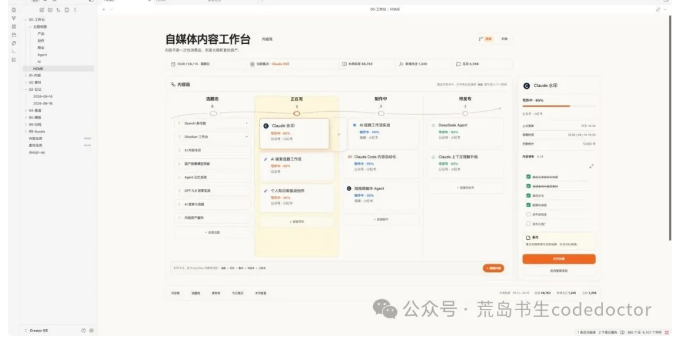
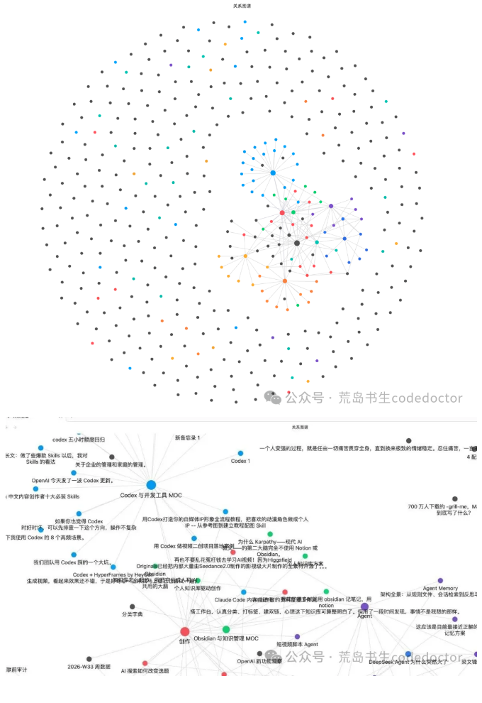
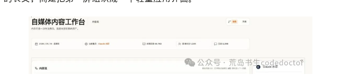
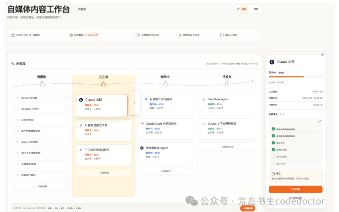
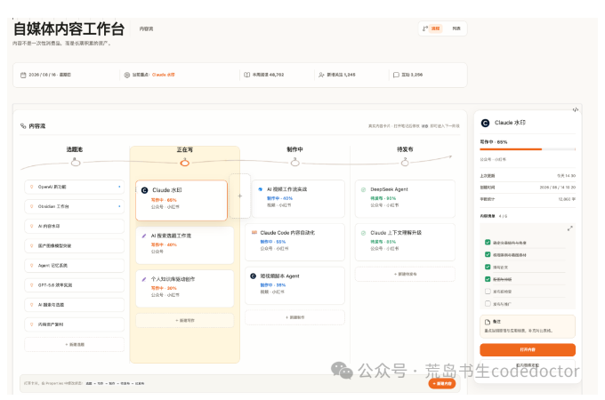

* 目录
{:toc}

[](/assets/img/wechat-archive/obsidian-creator-workspace/overview.webp)

画面里的文章和运营数字为演示内容。

作为AI行业博主，我平时同时写公众号和小红书。

AI 行业变化很快，一篇内容从产生想法到发布，通常要经过选题判断、资料收集、文章结构、正文撰写、配图、平台适配、发布检查和数据复盘。

只要手里同时推进三四篇，问题就会很快出现：选题记在聊天软件里，截图留在相册里，参考链接塞进浏览器收藏夹，正文又散落在不同文档中。

我并不缺一个写 AI素材的软件。

真正缺少的是一张能让我看清全局桌面：今天最该写什么、每篇内容走到哪一步、素材放在哪里、哪些内容已经发布、过去一周的表现怎样。

我想做的，是一张每天愿意打开的内容桌面：既能看清选题、写作、制作和发布，也能把每篇内容沉淀成以后还可以继续使用的本地资产。

于是，我在 Obsidian里设计了一套自媒体内容工作台，取名 Creator OS。当然它是在Codex 帮助下设计完成。

它的目标很明确：把选题、写作、制作、发布和复盘放进同一个本地系统。

打开 HOME，我能马上知道下一步该推进什么；进入内容库，又能看到所有文章和完整数据。

当你经过长期实践，组建了你的内容库，你会看到下方图里的关系图谱：

[](/assets/img/wechat-archive/obsidian-creator-workspace/knowledge-graph.webp)

*内容库的关系图谱。图片保留原文发布时的内容，可点击查看。*

## 01 我想解决的，不只是“资料放哪里”

很多人第一次整理知识库，会从文件夹开始：读书笔记放一个目录，灵感放一个目录，素材再放一个目录。这样的结构适合保存，却不一定适合持续创作。

因为内容生产关心的是状态。

同一个选题可能今天还在收集资料，明天进入写作，后天开始做配图，最后等待发布。文件本身没有变，创作阶段一直在变化。如果每改变一次状态就移动文件，目录会越来越难维护，相关素材和双链也容易变乱。

所以我先给这套工作台定了四个必须回答的问题：

1. 今天最值得推进的是哪一篇？
2. 当前有哪些选题、写作和制作任务？
3. 每篇内容关联了哪些素材、平台和进度？
4. 发布之后，哪些数据与经验值得留下？

有了这四个问题，首页就不需要容纳天气、时钟、音乐、习惯打卡和其他人生管理模块。它只服务于内容创作。

我也给整个系统留下了一句长期提醒：

内容不是一次性消费品，而是长期积累的资产。

一篇文章发布以后，标题、结构、案例、图片、读者反馈和数据都还有价值。只要这些信息被保存下来，以后的选题、改写、系列文章和跨平台发布都会更容易。

## 02 先设计内容生产线，再设计漂亮的首页

我把内容状态整理成一条简单的生产线：

选题→写作→制作→待发布→已发布。

“写作”指文章主体正在形成；“制作”包括配图、排版、视频、封面和平台适配；“待发布”表示内容已经基本完成，只等发布时间或最终检查。发布之后，内容进入复盘，而不是从系统里消失。

与这条流程对应，Vault 的目录也保持克制：

```text
00-工作台  HOME 与主题地图
01-内容    所有内容笔记
02-素材    图片、视频、链接与参考资料
03-日记    每日创作记录
04-复盘    周复盘与月复盘
90-模板    内容、素材、日记与复盘模板
99-归档    已退出日常视线的资料
```

所有内容文章都留在 `01-内容`，不按照阶段来回移动。状态、平台、进度、发布时间、阅读量等信息保存在 Properties 中。这样，文件路径稳定，双链稳定，工作状态又可以随时更新。

完整数据由 Obsidian 官方 Bases 管理。它可以按状态、平台、发布日期等条件筛选，形成选题池、正在写、待发布和最近发布等不同视图。HOME 则是一张本周快照，只摆放近期最重要的内容。

这个分工很关键。数据库负责完整，首页负责聚焦。如果把几十篇文章全部放到 Dashboard，首页很快就会退化成另一张冗长表格。

模板承担的是输入标准。新建内容时，标题、类型、状态、平台、进度和日期已经有固定位置；新建素材、每日记录和复盘时也使用各自模板。它减少了每次“应该记哪些字段”的犹豫，也让 Bases 后续查询更稳定。

## 03 首页第一屏，我放了哪些信息

首页决定了这套系统每天是否愿意被打开。因此我没有把它设计成一篇从上往下阅读的长文，而是把第一屏组织成一个轻量应用界面。

[](/assets/img/wechat-archive/obsidian-creator-workspace/workspace-header.webp)

*工作台顶部与内容入口。图片保留原文发布时的内容，可点击查看。*

顶部是标题和一句副标题，旁边提供“流程”和”列表”两个入口。流程适合每天判断进度，列表用于进入完整 Bases数据。

标题下面是一条紧凑的数据带，显示日期、当前重点、本周阅读、新增关注和互动。

[](/assets/img/wechat-archive/obsidian-creator-workspace/content-flow.webp)

*内容流与当前重点检查器。图片保留原文发布时的内容，可点击查看。*

页面中间是视觉权重最高的“内容流”。选题池、正在写、制作中、待发布四个阶段横向展开，一条柔和曲线把它们连接起来。阶段标题下方显示数量，当前阶段使用浅米色背景和橙色节点强调，其他区域保持白色与浅灰。

选题池使用紧凑列表，因为这里更需要看数量与主题；进入写作和制作以后，内容变成信息更完整的卡片，显示标题、平台、状态和进度。待发布区域则减少视觉干扰，让我快速确认哪些内容已经接近完成。

这条曲线、空心节点、状态点和小图标并非单纯装饰。它们让四列之间出现连续方向，也帮助我在不阅读所有文字的情况下分辨选题、写作、图文、视频和完成状态。

页面右侧是一张当前重点检查器。它展示内容标题、平台、进度条、更新时间、创建时间、字数、制作清单和备注。

这块区域解决了一个很实际的问题：我不需要打开五篇文章来比较轻重。只要把本周最重要的一篇放进右侧，首页就已经替我完成了注意力排序。

底部只保留内容库、选题池、素材库、今日笔记和本月复盘几个高频入口。它们的样式更像应用导航，不使用普通 Markdown 的蓝色链接列表。

## 04 让它看起来像产品，但仍然属于 Obsidian

这套工作台的视觉方向很克制。我希望它有 Apple 式留白和 Notion 式信息层级，但不能变成企业管理后台，也不需要依赖暗色背景、霓虹和复杂动画来制造“科技感”。

页面背景使用暖白，卡片接近白色，边框是很浅的暖灰。柔和橙色只负责当前焦点与主要操作，蓝色和绿色只用于少量状态。主要颜色大致可以归纳为：

暖白页面 #FBFAF7

白色卡片 #FFFFFF

深灰文字 #272723

柔和橙色 #ED7518

文字层级分为页面标题、区域标题、卡片标题、元数据和辅助说明。标题不需要全部加粗，次要信息也不会和主内容抢夺注意力。圆角、边框、阴影和间距都使用统一规则，卡片 hover 只做轻微变化。

为了更好的视觉效果，我单独制作了曲线轨道、CLaude 标识、选题灯泡、写作铅笔、图文书本、视频图标、完成标记和状态圆点。这些视觉资产全部放在 Vault内部，不依赖网络地址，复制到另一台电脑后仍然能够显示。

页面宽度也经过限制。Dashboard 比普通笔记更宽，但不会在超宽屏上无限拉伸；右侧检查器在桌面窗口中保持独立，窗口变窄后会移动到内容流下方。

## 05 交互做得真实，比看起来会动更重要

我给这套系统设定的实现顺序是：先使用 Obsidian 原生能力，再用 CSS 完成视觉，只有原生能力无法覆盖且确有必要时才考虑社区插件。

最终使用到的核心能力包括 Properties、Bases、Templates、DailyNotes、Bookmarks、Callouts 和内部链接。

用户无需安装 Dataview、Templater、QuickAdd，也不需要运行自定义JavaScript。这样做会放弃一部分表面上更炫的功能。例如，截至这套工作台交付时，官方 Bases 没有原生看板拖拽。

我没有制作一块看起来可以拖动、实际却不能改变数据的假界面，也没有为了拖拽强行加入重型插件。

阶段变化通过内容笔记里的 `状态` Property 完成。修改后，完整 Bases 视图会自动归类；HOME 作为本周重点快照，再调整对应卡片。它比纯拖拽多一个明确步骤，但数据来源清楚，安装和维护也更可控。

同样，首页上的阅读量、新增关注和互动是周复盘的手动摘要，不会自动登录或抓取任何平台账号。这样既避免账号权限风险，也防止 Dashboard 用一组无法验证的“实时数据”营造效果。

关闭 CSS Snippet 后，HOME 仍然是一篇结构完整的 Markdown，内部链接、Properties、Bases 和模板全部保留。

对我来说，这是判断一个 Obsidian模板是否可靠的重要标准：视觉可以关闭，数据不能跟着消失。

## 06 最后得到的，是一套可以直接使用的 Creator OS

现在打开这套工作台，我可以从选题池挑出本周内容，把其中一篇设为当前重点，进入写作后更新进度和制作清单。需要配图时进入素材库，完成后把状态改成待发布；发布数据在周复盘中记录，再把值得复用的标题、结构和素材留在原笔记里。

整个过程没有要求我更换写作工具，也没有把所有资料锁进一个新的在线服务。

内容依然是本地 Markdown 文件，文件夹、Properties、模板和 CSS 都可以继续修改。

为了让它可以交付给其他创作者，我整理了演示版和纯净版两种发行包。演示版放入示例文章、离线图标和明确标注的模拟数据，适合预览完整效果；纯净版保留 Dashboard、内容库、素材库、模板和数据结构，不包含虚构文章与统计，解压后可以直接填写自己的内容。

交付内容还包括快速开始、详细使用说明、更新记录和个人使用许可。用户只需要安装支持官方 Bases 的 Obsidian，解压 ZIP，选择“打开本地仓库”即可开始使用。

[](/assets/img/wechat-archive/obsidian-creator-workspace/workspace-overview.webp)

*Creator OS 工作台全貌。图片保留原文发布时的内容，可点击查看。*

这套工作台更适合同时维护多个选题、在公众号和小红书等平台持续发布、愿意保留本地文件，并且希望自己掌控数据结构的人。

**一个内容系统不需要替创作者思考。它需要保存已经做过的工作，减少寻找与切换，让有限的注意力回到创作本身。**

接下来我会继续分享这套工作台的使用方法、内容模板和实际创作案例。

如果你也在搭建自己的内容系统，或者希望定制 Obsidian工作台、个人知识库与数字产品，可以在公众号后台留言。

也欢迎告诉我，你现在最难管理的是选题、素材、进度，还是发布后的复盘。

---

原载：[微信公众号「荒岛书生codedoctor」](http://mp.weixin.qq.com/s?__biz=MzUxMjYzMzMyNg==&mid=2247485527&idx=1&sn=d92c18a7884cc889db5f1184c7068403&chksm=f96038d6ce17b1c09c24caaa226bea9269578f6a08490f9f493c3b4b399897bb8ef70e1db02f#rd) · 首发：2026-08-17。本文按原稿整理为网页阅读版，保留发表时的产品版本、案例与数据口径。
