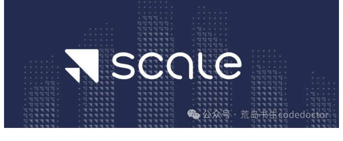
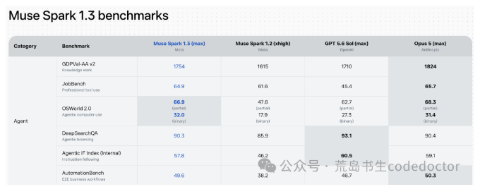

* 目录
{:toc}

**最让人难受的失败，是你明明做得更好，最后却没人选你。**

你的产品功能更完整，细节更扎实，团队也更拼。结果，客户签了别人。

你反复检查产品，想知道哪里还不够好。直到某一天才意识到：客户可能根本没有理解，你究竟好在哪里。

硅谷科技新贵 亚历山大Alexandr Wang 在2024年一场访谈里说了一句话：

Perception is more real than reality.

认知比现实更真实。

这话听着有点刺耳。认真做产品的人尤其容易不舒服：难道把东西做好，还不够吗？

但顺着他的讨论往下读，就会发现，他说出了产品进入现实世界后的一种处境。

这场访谈发布于2024年12月，当时 Wang 是 Scale AI 的创始人兼 CEO。Scale AI 主要为人工智能模型提供训练数据。讨论从创业初期的不确定性，一直延伸到企业销售、AI 产品和创始人的独立判断。

我的感受很直接：这人真厉害。

让人佩服的，是他知道那些漂亮道理到了公司里，具体会在哪儿卡住。许多我们以为靠技术就能解决的事，最后都要经过人。

*Scale AI。图片保留原文发布时的内容，可点击查看。*

## 01 客户如何理解产品价值

Wang 谈到，大型组织未必会直面复杂的现实。做企业产品，需要改善实际表现，也需要塑造客户对它的认识。

他还提到，Palantir 这家为企业和政府提供数据分析软件的公司，长期给新员工发表演书。不过，他随后补充：企业仍然需要做好产品，创造价值。

这个前后关系特别重要。

技术人员容易觉得，产品摆在那里，功能也能演示，好不好一看就知道。

但想象一个企业采购场景：你做了一套工具，能让客服处理工单更快。现场试用的人觉得不错，项目却迟迟推进不了。

用工具的客服，关心每天能少做多少重复劳动。部门负责人关心实施之后要不要重新培训。采购关心合同和供应商稳定性。最终批预算的人，可能只想知道这笔钱花出去，能不能给公司带来一个说得清的结果。

你在演示里证明了功能能用，却还没有回答这些人的问题。更麻烦的是，他们未必会当面告诉你。

有人说再研究一下，有人说回去内部讨论。你以为对方还在比较产品，实际上，他们还没形成一个能够共同接受的购买理由。

这也是为什么“让产品自己说话”有时很吃亏。产品能展示自己的功能，却没法替客户写出那份内部立项说明，也没法自动消除他们对实施过程的担心。

表达价值，需要理解对方的处境。

同样一句“提高效率”，研发团队可能觉得已经解释得足够清楚，客户却还想知道：提高谁的效率？需要谁配合？一个月后如何判断效果？

把这些问题回答出来，产品的价值才有机会进入决策。

当然，销售过程中也会出现另一种危险：演示越来越漂亮，承诺越来越大，实际交付却跟不上。

所以，Wang 那句关于做好产品的补充不能丢。客户的认知会随着使用经验变化，最初的信任最终要接受实际体验的检验。

对认真做产品的人来说，这段话反而是一种提醒：你辛苦做出来的价值，值得被认真解释。别把沟通当成产品完成后随手补上的事情。

## 02 自信如何影响团队行动

Wang 用 Palantir 举例，谈到团队对自身产品的强烈信念。他认为，创业者需要足够的自信，才能投入竞争。

但他也回忆了早期的焦虑：让人恐惧的，是公司可能已经失败，自己却几年后才发现。

自信的人照样会焦虑。焦虑也不会因为你决定创业，就自动消失。

假设你刚开始做一个 AI 产品，每次查资料，都发现已经有人在做类似的东西。别人融资了，别人上榜了，别人发布的视频看起来比你的产品成熟多了。

你很容易产生一种错觉：自己才刚起步，比赛就已经结束了。

接下来，你可能花越来越多时间研究别人，越来越少时间接触用户。每看到一个新发布，就想换一次方向。项目还没被市场判输，团队已经开始撤退。

这时，自信的作用就很具体了。它让你愿意把一个尚未得到认可的判断，继续做完一段，拿到真实反馈。

但自信需要对象。

“我们一定会成功”很难指导工作。“我们更理解这类用户的某个麻烦，而且愿意把它解决到底”，就具体得多。

你知道接下来应该找谁，应该验证什么，也知道哪些批评值得听。

这里的难处，是同时承受两件事：你需要相信自己有机会，也需要接受自己的判断可能出错。

有时，客户没有选择你，说明表达不够清楚；有时，产品本身确实没有解决一个足够重要的问题。

如果每次失败都归因于别人不懂，就很难进步。如果每次受挫都推翻自己，又很难积累。

创业者要在真实反馈里调整相信自己的方式。这件事比喊一句“保持自信”难多了。

## 03 工作的价值如何衡量

Wang 谈到，Scale 的工作包含大量繁琐的运营问题。他强调，应当关注解决问题带来的经济价值，而不只看技术难度。

这点特别容易戳中做技术的人。

一个问题足够难，解决之后容易获得同行的认可。一个问题足够烦，处理之后往往只是让大家的日子恢复正常。

比如，公司有一批历史文档，格式混乱，版本不一致，同一件事有好几种说法。

你想做一个能回答内部问题的 AI 工具，很快就发现，模型选型只是工作的一部分。更多时间花在整理材料、确认哪份文件有效、找人补充遗漏信息上。

这些工作很难写成令人兴奋的发布文案。但如果没人做，系统回答得再流畅，也可能在一本正经地使用过期信息。

再比如，一套报销流程，每个人都知道它麻烦，财务每天也在重复提醒，可它不涉及什么高深算法。

把已处理好，未必能让技不分享会上响起掌声，却可能节省很多人的时间。

对于普通用户，道理也一样。

挑 AI 工具的时候，很容易被最炫的演示吸引。真正开始使用后，才发现自己每天最需要的，可能是可靠地整理一份表格，或者从几十页材料里找到一个明确答案。

这些任务不够惊艳，但它们经常发生。问题出现的频率、解决它的成本，以及它对工作的影响，往往比“展示效果有多酷”更值得关注。

Wang 的这个观点让我佩服，因为它给了那些埋头解决麻烦的人一种很具体的认可。你处理的事可能不体面，处理得好，却很有价值。

## 04 AI 能力如何进入工作流程

谈到能够连续执行任务的 AI 助手，也就是 Agent，Wang 在2024年这场访谈中指出，模型的多轮可靠性仍然不足，同时也认为，产品设计中存在很大的机会。

模型有能力，用户还需要一种能够使用这种能力的方式。

这句话放到日常工作里很好理解。

你给一个人推荐 AI 工具，告诉他“什么都可以问”，听起来像是给了他无限可能。但对方打开输入框，往往先卡在：我该问什么？

然后是：要提供哪些材料？怎么判断回答有没有错？得到结果后，又该放到哪里？这些步骤，都需要用户自己摸索。

如果他只是想处理一件工作上的小事，却要先学习半天如何与模型配合，这个工具就很难成为习惯。

试想一个会议场景。

一个产品允许你上传录音，再自己要求它总结。另一个产品在会议结束后，直接呈现讨论结论、待办事项和需要确认的问题，并让你方便地修改。

背后可能都有模型在工作，用户承担的劳动却不同。后一种体验替用户安排了步骤，也让结果更容易检查。

当然，自动生成待办不等于能够自动完成待办。涉及权限、执行结果和错误处理时，产品还要继续回答新的问题。

所以，产品设计不能只考虑“怎样让 AI 多做一点”。也要考虑它做错时，用户能否发现；需要确认时，能否停下来；执行结束后，能否看清结果。

对产品开发者来说，这是大量具体工作的起点。对用户来说，判断一个 AI 工具好不好，也可以换一个角度：用它处理完一件事，我到底省下了多少劳动？

## 05 如何找到当前的瓶颈

Wang 还谈到高质量数据对训练的重要性。他当时认为，合成数据没有解决所有限制；谈及中美竞争时，也关注各国会采用怎样的 AI 技术体系。

这些话题离普通用户似乎很远，但其中有一个很实用的思考方法：效果遇到瓶颈时，先检查限制究竟在哪里。

比如，你做了一个知识库，回答质量很差。最容易想到的办法，是换更强的模型。

但如果知识库里缺少关键材料，旧版本和新版本混在一起，或者检索总是找不到正确的那一页，换模型可能只能让错误答案变得更流畅。

同样，团队投入了更多预算，未必就会自动得到更好的产品。

如果没人定义什么叫“回答得好”，测试材料又只覆盖最容易成功的任务，就很难知道钱花在哪里最有效。

一个项目做着做着，限制它的因素会变化。起初可能是能力不足，后来可能是材料质量，再后来可能是用户根本无法把结果接入自己的工作。

这时，继续重复最初有效的办法，就可能越投入越失望。

理解瓶颈需要耐心。它不像展示一个新功能那么显眼，却能决定后面的投入是否值得。

## 06 如何形成自己的判断

Wang 对 AI 创业者的另一条建议，是形成独立判断，并持续向现实学习。

这大概也是今天最难的一件事。信息太多了。

一篇文章告诉你某种产品形态已经过时。另一篇文章告诉你某个方向潜力巨大。融资新闻让人兴奋，失败复盘又让人怀疑。每种观点都有人说得信誓旦旦。

如果你总是用最新看到的观点解释一切，自己的判断就很容易被不断刷新。

今天想做通用助手，明天想做垂直工具。产品还没有获得足够反馈，方向已经换了好几次。

对普通用户，这种情况也很熟悉。

刚学会一个工具，又觉得应该换到另一个。收藏夹越来越长，工作里的实际问题却还没有解决。

独立判断并不意味着忽略外部信息。它需要一个具体的问题作为参照。

你到底希望改善什么？什么结果算有效？当前的信息，能够帮助你回答哪一部分？有了这些依据，别人的观点才比较容易被消化。

你可以接受其中有用的部分，也可以暂时保留意见，而不必因为某个人说得很有把握，就立刻修改全部计划。

创始人需要这样做，普通 AI 用户也需要。工具会继续变化，热点也会继续变化。一个清楚的任务，能够帮助你判断哪些变化与自己有关。

否则，很容易忙着跟上所有动静，却始终没有完成自己的工作。

这场访谈最打动我的，就是 Wang 对这些具体困难的理解。

他谈产品，也谈客户如何作决定；谈自信，也承认早期的恐惧；谈技术进展，又愿意认真讨论那些繁琐、缺乏光环的问题。

一个人说“做好产品”，很容易。

知道产品做好之后还会在哪儿受阻，知道团队为什么会动摇，知道那些不起眼的劳动为什么值得做，需要更深的经历。

所以，回到开头那句话：产品更好，为什么还会输？

原因可能藏在许多地方。你可能选错了问题，也可能没有把价值讲清楚；可能高估了一个漂亮演示，也可能在需要继续验证的时候，先被别人的声势吓退了。

这些话听完，会有一点不舒服。但它们也让人重新获得一种踏实感：还有具体的事情可以做。

去确认问题，去接触客户，去处理那些没人愿意碰的麻烦，去让自己的产品经得起实际使用。

认真做事的人，也该认真争取被理解。

2025年6月，Meta 收购亚历山大•王的公司 Scale AI（大部分股权），Wang加入Meta。

2026年9月，亚历山大•王带队Meta AI 大模型，推出 Muse Spark 1.3，宣布已经追上 OpenAI 与 Anthropic第一梯队。

*原文所附 Muse Spark 1.3 评测图。图片保留原文发布时的内容，可点击查看。*

## 资料来源

- [South Park Commons：Alexandr Wang 访谈](https://blog.southparkcommons.com/p/alexandr-wang-scale-ai-and-the-startup-45f)
- [访谈原视频](https://www.youtube.com/watch?v=CEebe451GZs)

---

原载：[微信公众号「荒岛书生codedoctor」](http://mp.weixin.qq.com/s?__biz=MzUxMjYzMzMyNg==&mid=2247486096&idx=1&sn=927b43310f0659d6ecf767b2d42e0610&chksm=f9603a11ce17b3074eb4e4ba38041290bfcef09e296e111d5fefa1c6384f47b208d676e3564f#rd) · 首发：2026-10-04。本文按原稿整理为网页阅读版，保留发表时的产品版本、案例与数据口径。
