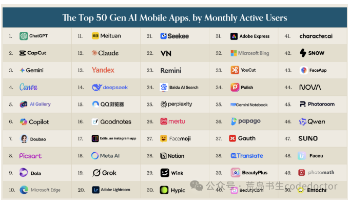
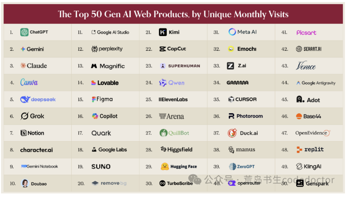
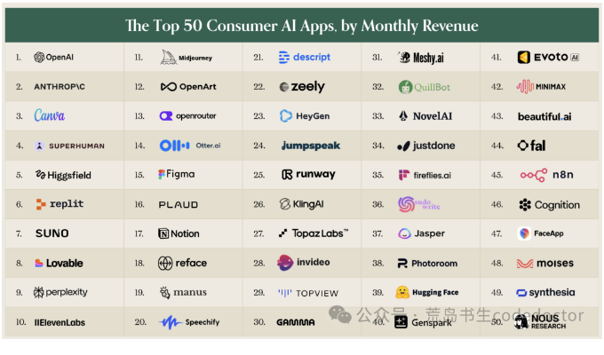
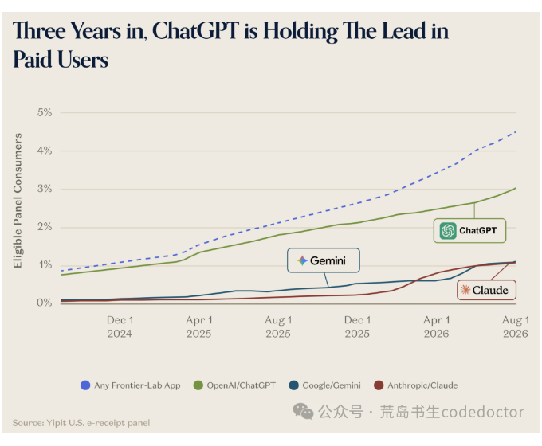
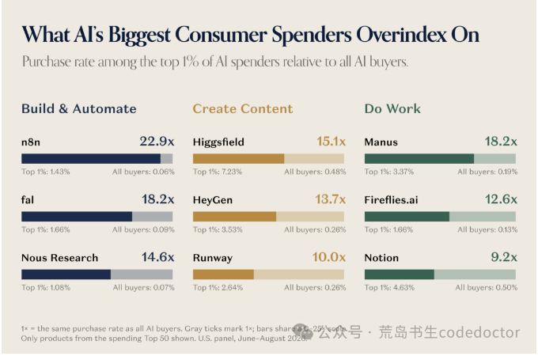
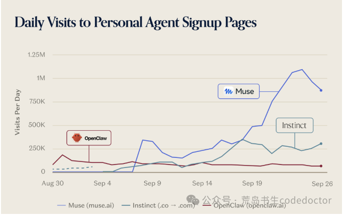

* 目录
{:toc}

过去一年，我在公司做AI创新项目，模仿用户、运营、产品、财务、开发不同角色切换仿佛人格分裂。当然大部分时间还是都扑在开发上，日常使用Codex和Claude Code。今年，我又开始做AI自媒体。

读一份AI行业报告时，这几个身份会把我的注意力拉向不同的地方。

这是一篇万字长文，细节分析太多，建议收藏后慢慢看。

作为开发者，我关心工具能不能把事情做完。站在公司项目的角度，我关心一项能力有没有持续使用的理由。写给读者时，我还得想：这么多变化，哪些值得占用大家的时间？

最近，a16z发布了第七版生成式AI消费应用报告。让我停下来的，是两个放在一起很不协调的数字：**903美元**和**25美元**。

在报告观察到的美国消费者样本中，为AI花钱最多的**前1%用户**，每月平均支出**903美元**。处在付费人群中间位置的用户，每月支出只有**25美元**。

两者相差约36倍。

看到这里，你可能会有两种反应。一种是，这些人疯了吗，每个月为软件花这么多钱？另一种是，他们是不是已经找到了什么，而自己还在偶尔打开AI问几个问题？

如果你最近频繁看AI内容，第二种感觉大概不难理解。产品发布越来越密集，演示越来越惊人，收藏夹里的教程越来越多。每看完一轮，待学习清单又长了一截。

但这份报告同时告诉我们：付费用户中，**只有13%**还会为第二款及以上AI产品付钱。

原来，每天讨论哪个模型更强、该再订阅哪个工具的人，和绝大多数使用者，过着很不一样的AI生活。

我想借这份报告，把这种差异讲清楚。有人把AI当作偶尔用一下的服务，有人已经围绕它安排工作；有的产品访问量很高，有的产品并不显眼，却有人持续付钱。

大公司、小团队和普通用户，都在这几种现实之间寻找自己的位置。

读懂这些差异，比再收藏一张工具清单更能帮助我们决定：

接下来学什么，做什么，以及哪些事情可以暂时放下。

## 01 三张榜单，呈现了三种不同的AI生活

a16z是一家知名硅谷投资机构。这份报告发表于2026年10月5日，是他们连续追踪消费级AI应用的第七期。

过去，这个系列主要有两张榜：网页产品榜和移动应用榜。网页榜使用Similarweb的访问数据，移动榜使用Sensor Tower的月活跃用户数据，各取前50名。

*报告中的移动应用月活榜。图片保留原文发布时的内容，可点击查看。*

*报告中的网页产品访问榜。图片保留原文发布时的内容，可点击查看。*

这次增加了第三张：依据YipitData观察到的美国个人银行卡消费，排列厂商的消费支出。

*报告中的消费支出榜。图片保留原文发布时的内容，可点击查看。*

如果把三张榜放在一起读，一个变化就会出现：我们熟悉的“AI行业”，远远不止几个聊天机器人。

网页榜前三名是ChatGPT、Gemini和Claude。往下看，Canva排第四，DeepSeek第五，Notion第七，豆包第十。设计、知识工作和通用助手都在里面。

到了移动端，ChatGPT仍然第一，但第二名变成CapCut，第三名Gemini，第四名Canva。豆包排第七，Claude排第十二。榜单里还能看到修图、视频、翻译和学习相关应用。

对一位普通手机用户来说，AI可能出现在一段视频、一张照片，或者一次翻译里。他未必关心背后的模型，也未必把自己称为“AI用户”。

这对我们理解普及很有帮助。开发者打开编程工具，和普通用户打开熟悉的手机应用，可能都在使用AI，但需要的入口和愿意投入的学习时间完全不同。

生成式AI已成为核心体验的老产品，也能参与排名。因此，应用总月活反映整个产品的使用规模，其中包含原有功能；具体有多少人使用AI功能，还需要单独的数据。

第三张消费支出榜，又换了一幅面孔。

前三名依次是OpenAI、Anthropic和Canva。Superhuman排第四，Higgsfield第五，Replit第六，Suno第七，Lovable第八，Perplexity第九，ElevenLabs第十。

这张榜的统计单位有些不同：OpenAI、Anthropic使用的是厂商名称，旗下单一功能的收入需要进一步拆分。Gemini则因收入无法从Google更广泛的消费业务中可靠拆分，被排除在外。

数据覆盖美国消费者样本中的付款，企业合同、其他地区和支付渠道并未被完整统计。把它读作这部分消费者的钱花到了哪里，比把它当作全球公司营收排名更准确。

理解这些前提之后，再看几个对照，就很有意思了。

Replit在网页榜排第48，在消费支出榜排第6；Higgsfield分别排第28和第5；OpenRouter分别排第40和第13。Notion的顺序则相反，网页榜第7，支出榜第17。

访问量的排序和花钱的排序，差异就这样呈现出来。两榜的样本与统计时期不同，名次对照能帮助发现值得研究的产品；要计算转化率和每位用户的收入贡献，还得取得同口径数据。

报告还给了一个更直观的总数：支出榜前50家厂商中，**有29家**没有进入网页或移动端流量榜。

你很少访问一家公司的官网，却可能天天使用它的桌面软件。一个专业工具只服务某类工作，也可能拥有愿意持续付费的人群。仅盯着网页访问，会漏掉这些使用行为。

同时进入三张榜的只有七家：ChatGPT、Claude、Suno、Perplexity、Photoroom、Canva和Notion。报告将ChatGPT及其所属厂商描述为三榜领先者。

所以，这份报告首先改变的，是看市场的方法。热闹程度、日常使用和付费意愿，应该分别观察，再寻找它们之间的关系。

## 02 每天使用AI的人，容易高估别人的使用程度

报告引用的调查显示，接近一半美国消费者表示使用AI，但每天使用的比例约为四分之一。

而在YipitData的美国电子收据样本中，2026年8月，符合统计条件的消费者里，有**4.5%**持有ChatGPT、Gemini或Claude至少一种有效个人付费订阅。一年前，这个比例是2.1%。

*报告样本中的付费用户变化。图片保留原文发布时的内容，可点击查看。*

一年多来，比例已经翻倍有余，付费覆盖仍然有限。其他AI产品的付款、企业替员工购买的服务，都在这个**4.5%**的统计范围之外。

这组数字让我首先想到的，是做AI创新项目时应该留意的一种偏差：每天使用工具的人，很容易把自己的熟悉程度，当成其他人的起点。

对开发者来说，安装工具、配置环境、补充上下文，可能属于可以接受的准备工作。对于只想尽快完成本职任务的人，这些步骤可能已经足够劝退。

再考虑一个更普通的例子。假设一位同事要整理会议记录，原来只需在熟悉的文档里记几段文字。新工具要求他录音、上传、等待，再核对人名和行动项，最后搬回原来的系统。

如果会议很长、记录要求很高，这套操作可能划算。如果只是十分钟的小会，原来的方法也许更省心。

同一项AI能力，在两种情境里可以得到完全不同的评价。用户是否愿意采用，取决于整个过程减少了多少麻烦。

从第一性原理往下拆，一项工作总得有人提供信息、做出处理、检查结果，并承担出错后的影响。AI可以改变其中一些环节，但剩下的工作不会因为演示好看就自动消失。

如果生成初稿省了十分钟，检查却多花十五分钟，用户的感觉可能很直接：试过了，下次还是自己来。这是一个假设场景，却能解释为什么“能生成”与“愿意长期使用”之间有距离。

对公司里的创新项目，我认为需要特别观察第二次、第三次使用。第一次可能来自培训、好奇或同事推荐；后续是否主动回来，才更接近日常价值。

还要看用户把什么留在系统里。如果大家试完一次，就回到原来的表格和文档中继续工作，那次尝试至少还没有改变主要流程。

这不一定意味着项目没有价值。也可能是产品还缺一个连接步骤，或者选错了最先服务的人。分析这些原因，比把问题简单归结为“同事不愿学习”更有帮助。

对于普通读者，这组数据也可以减轻一种无谓的压力：你并没有因为没订阅三四个工具，就自动落后于所有人。

与此同时，付费比例一年多来明显增长，说明使用习惯也在变化。值得学习的东西确实越来越多，但学习可以围绕自己的任务展开，不必按照发布会的节奏排课。

## 03 每月903美元，背后是一种工作账本

报告里，花钱最多的前10%用户，贡献了约一半的观察支出。前1%贡献19.5%，超过支出最少的后50%加起来16.6%。

这就是报告所说的高度集中：少数人花得非常多，而多数付费用户的支出相对有限。

月均**903美元**的那群人，过去18个月的支出还**增长了80%**。中位付费用户维持在每月**25美元**左右，支出没有明显扩张。

他们更偏好购买什么？

报告列出的方向包括自动化、产品开发和创作。高消费群体更倾向购买n8n、fal、Manus、Nous Research相关工具，也更倾向购买Higgsfield、Figma和HeyGen等创意产品。

*高支出用户的产品购买偏好。图片保留原文发布时的内容，可点击查看。*

这类用户被称为prosumer，可以理解为有专业工作需求的个人用户。开发者、独立创作者、小型经营者，都可能落在这个范围里。

为什么一些人愿意花这么多？

一种合理解释是，他们使用另一套账本。

普通用户可能把月费和其他生活订阅比较。工作型用户则可能把它和项目时间、外包费用、可完成的订单放在一起计算。

假设一位创作者每周都有固定交付，某个工具能帮助他完成原本需要反复制作的素材，这笔订阅就有机会与具体产出对应。偶尔做一次同类内容的人，未必得到同样的回报。

频率在这里很重要。每次节省十分钟，一个月用两次，与每天用几次，最后体现出的价值相差很远。

任务质量也重要。如果工具让原本无法完成的工作变得可行，价值可能大于节省几分钟。但如果结果无法交付，生成再多也只是在增加待筛选的材料。

作为开发者，我会特别关心后者。写出代码只是任务的一部分。代码是否符合已有业务，能否与项目其他部分一起运行，修改以后有没有引入问题，都影响它能否成为可交付的结果。

做内容也是一样。生成一篇长文，只能证明工具产出了文字。材料有没有读懂，事实有没有混淆，读者是否愿意看下去，还需要继续处理。

因此，支出集中可以支持一个判断：AI已经找到一批愿意为工作和创作投入的人。它没有证明这些人都提高了收入，也没有证明月费越贵、订阅越多，结果就越好。

一个人完全可能买了很多工具，却没有建立稳定用法。高额支出里也可能包含探索成本、重复购买，甚至没来得及取消的订阅。

对我们有用的，是继续问钱花到了哪里，解决了什么，以及这种收益是否能重复。

前面提到的13%，也在这里变得更有分量：在报告观察的付费人群中，愿意为第二款及以上AI产品付钱的人仍是少数。

做产品的人如果想成为用户的“第二笔AI订阅”，就需要给出额外的理由。与已有助手回答差不多，通常不足以解释为什么还要再付一次钱。

用户可能需要的是某种更好的声音效果、一套省事的操作过程，或者对一项专业任务的可靠处理。付费理由越具体，就越容易验证，也越容易发现它是否根本不存在。

对我这样开始做AI内容的人，这组数据还有一个提醒。阅读量高的选题，和读者愿意长期投入的工作，不一定重合。介绍新工具时，除了展示能力，还应把它适合谁、多久会用一次讲清楚。

**让读者少买一个不需要的订阅，也是内容可以提供的帮助。**

## 04 三家大模型公司，正在培养不同的使用习惯

如果只看总体规模，ChatGPT仍然领先。

报告给出的8月数据中，它的网页访问量约为Gemini的两倍、Claude的六倍；移动端月活跃人数约为Gemini的2.5倍、Claude的14倍。

到了美国消费者付费订阅，差距的形状就变了：ChatGPT的规模约为Gemini或Claude各自的三倍。

Claude的移动用户规模相对小，但付费位置更靠前。这让我们有理由继续研究它服务的人群，而不只看谁的总用户最多。

报告回顾了一条发展过程。2023年9月的第一版网页榜里，Claude还没有上榜。到了这一期，它已经位列第三，超过DeepSeek和Perplexity。

今年，Claude一度在美国消费者付费订阅人数上超过Gemini。后来，Google将原有付费用户迁移到AI套餐，两者又变得接近。

这里的新增人数包含两种来源：原有付费关系的迁移，以及用户为新增AI能力作出的购买。理解套餐调整，才能更准确地理解订阅增长。

按照报告的梳理，Claude上半年的变化伴随几类事件：1月推出Cowork，4月推出Claude Design，6月发布Fable 5；2月末，Anthropic与美国国防部的争议又带来了大量公众关注，Claude首次登上美国免费应用榜榜首。

这一阶段，产品能力、使用入口和公众注意力都在变化。它们与增长同时出现，各自贡献了多少，还需要进一步的数据。

下半年，走势又发生变化。YipitData的全球桌面样本记录到，Claude在7月和8月的平均每日会话量下降；美国电子收据样本则显示，付费新增放缓、流失上升。

同期，ChatGPT伴随7月的GPT-5.6系列和ChatGPT Work发布重新加速。报告讲的是这一段时间里的变化，无法由此宣布谁已经永久获胜。

更能帮助理解两家公司差异的，是高价套餐结构。

Claude付费消费者中，**7.3%**使用起价每月100美元的Max套餐。报告给出的Google和ChatGPT对应高价订阅占比，分别是1.3%和1.1%。

这是各自付费人群中的套餐结构。Claude的高价套餐占比更高，而总收入还取决于付费用户规模和其他收入来源。

报告还指出，Anthropic明确选择不在Claude中投放广告，通过订阅变现。对这类模式而言，产品需要持续提供让付费用户愿意续费、升级的价值。

三家公司过去半年的**127次产品发布**，也能看出这种分工。

Anthropic的方向更集中于专业工作，报告列举了Claude Design、Code Review和Claude Science。Google更突出创意模型，包括音乐、视觉等方向的推进。OpenAI同时发展工作与生活相关产品，覆盖企业工作、创作、健康、财务和求职等场景。

它们仍有大量重叠，但投入的重点已经不同。对某个产品的评价，也需要放回它服务的任务里。

我们可以喜欢某个模型，也可以经常使用它。但如果从自己的一项擅长任务，直接推出所有用户都应该选它，就跳过了很大一部分现实。

用户构成的数据也支持这种提醒。

在记录了性别信息的消费样本中，男性贡献了OpenAI支出的58.5%，在Anthropic中则为76.5%。

收入分布图也显示，Anthropic的消费支出相对于整体样本，更偏向高收入家庭。

我作为一个中年男性开发者，恰好更需要记住这件事：自己的工具体验有价值，但自己的位置并不代表整个市场。做内容时尤其如此，不能把同行熟悉的东西，当成普通读者已经掌握的常识。

报告中的另一个数字是，美国ChatGPT订阅用户里，**只有8%**同时订阅Claude。大多数人没有同时购买这两家的服务。

预算、任务和习惯都可能影响选择。无论具体原因如何，同时购买两家的用户只是其中一小部分；网上频繁切换、逐项比较的讨论，需要放回这个背景里理解。

如果要作出选择，我更愿意把同一项真实任务交给工具，看它理解了多少业务背景，需要多少次修改，最后的结果能否验收。任务和要求变了，就重新比较。

**模型会升级，产品也会变化。能重复执行的判断方法，比记住今天谁排第一更耐用。**

## 05 个人Agent进入聊天窗口之后，竞争变得更具体了

前面讨论的高消费人群，仍然偏向工作和创作。报告接下来提出的问题是：AI怎样进入更多人的日常生活？

个人助理，是它重点关注方向。

这里说的Agent，可以理解为能够围绕目标继续执行动作的AI。用户提出需求后，它可能查找信息、操作软件、联系服务，尝试完成后续步骤。不同产品实际能做什么、需要多少人工参与，差别仍然很大。

报告回顾，3月时，像OpenClaw这样的产品对大多数消费者还不够容易使用。半年后，一批个人助理产品开始报告数十万用户，包括Instinct、Tomo、Poke、Lindy和Town；大公司也推出了相关产品。

变化的一部分，发生在入口上。

有的产品希望你直接发消息、发邮件，甚至打电话。iMessage成为这段时间一个受关注的渠道。Instinct在8月从这里启动，DoorDash也推出了通过消息下单的助理。

对用户来说，学习一套新软件与给联系人发消息，是两种不同的起步成本。熟悉的入口，可以让第一次尝试更容易发生。

这让我想到公司里的AI应用。一个新系统即使能力很好，也要与员工已经习惯的沟通、文档和业务工具争夺注意力。如果任务能在原来的入口发起，产品就减少了一次切换。

当然，入口省下来的步骤，不能被后续返工全部吃回去。助理要让人继续使用，仍然得把交代的事办好。

*个人 Agent 注册页面访问量。图片保留原文发布时的内容，可点击查看。*

个人智能助理产品Instinct在8月末到9月初约三周内超过十万用户，当时仍采用邀请制。

Meta在9月9日推出Muse，覆盖浏览器、桌面、移动应用和WhatsApp。据报告描述，它首周达到约二十五万日活跃用户，不到一个月超过五百万次下载，当时只在美国和加拿大提供服务。

这些数字足以说明产品引起了关注。不过，同样是这两个市场，Threads当年上线前22天的下载量超过一千五百万。大型平台可以迅速带来初次尝试，后续是否留下还要单独观察。

报告引用的另一项分析也提醒我们，早期用户的兴趣仍然集中。AssistantBenchmark负责人David Pawlan分析了七个早期用户群的讨论，编码和技术自动化是讨论最频繁的任务领域。

个人Agent正在吸引更多尝试，但早期讨论仍带有技术用户的特征。要了解普通消费者的使用习惯，还需要观察更广的人群和更长的时间。

更值得研究的变化，是用户开始授权它们花钱。

Instinct创始人Noah Shinn称，40%的用户会在三周内绑定个人信用卡。对于绑定卡并实际发生购买的用户，月均经由Instinct完成的消费约为1,300美元。

他还称，产品的年化交易规模已超过10亿美元，其中大约一半来自旅行。用户愿意把支付动作交给助理，产品接触到了比回答问题更接近消费决策的位置。

设想一次旅行安排。提出“帮我找一张合适的机票”很容易。怎样理解合适，什么时候允许下单，改签要求如何处理，预算发生变化怎么办，都需要落实到动作上。

在这种场景里，建议错误与执行错误的后果不同。产品需要让用户看得见关键决定，在重要步骤保留适当确认，并让操作结果可以追踪。

这也是开发者视角能提供的价值：一个任务有起点、有结束状态，也会遇到中断。演示通常展示顺利完成的过程，日常使用还需要处理没买到、没保存、没收到确认的情况。

平台关系同样影响执行。报告提到，Amazon在不到两周内封锁了Muse的访问；Shopify、Instacart、OpenTable、Expedia、Ticketmaster和Plaid等平台则签署了官方集成。

这意味着，助理再聪明，也需要获得外部服务允许的操作方式。能否可靠调用商品、支付和预订服务，会影响最终体验。

沿着这个变化推演，谁负责呈现选项、谁接近购买决定，可能成为平台在意的问题。这是对产品位置的分析；报告中的几次开放与封锁，并没有给出所有平台作决定的具体原因。

对做AI项目的人而言，这一节最实际的启发是：连接现有系统、明确操作权限、处理失败后的恢复，应该和模型能力一起进入产品设计。

用户不会因为其中某个环节很难，就降低对最终结果的要求。承诺替他办事，就需要把“办到哪一步了”讲明白。

## 06 大公司已经进场，小团队还可以在哪些地方做好

这期榜单里，首次出现的产品**只有11个**，是七期以来最少的一次。头部名单越来越熟悉，Canva、Notion和Figma等老产品也占据重要位置。

Google一个公司，就有Gemini、NotebookLM、AI Studio、Labs和Antigravity五个网页榜条目。

对一个做新产品的团队来说，这种名单容易带来压力：一个功能刚做出来，大公司也加上了，用户还有什么理由留下？

这个担忧需要认真处理，但报告仍然列出了四类可能会吸引用户的产品。

第一类，在特定任务上拥有差异化模型。

音乐生成产品Suno，网页榜第19，消费支出榜第7。语音产品ElevenLabs分别排第25和第10。Midjourney、HeyGen、Kling和Topaz Labs也进入了支出榜。

这些产品围绕各自的模型能力建立体验。即使通用模型持续扩展，用户仍然可能为某种声音、画面风格、控制方式或专业结果付费。

对创作者来说，“能生成一张图”和“能反复得到适合这个项目的图”，中间有很多具体要求。人物一致性、修改成本、素材组织方式，都会影响一次创作是否顺利。

这些付费行为说明专业需求仍然存在。随着新模型改变能力边界，专业产品也需要继续改善效果和工作体验。

第二类，把不同模型组织成适合任务的体验。

报告以Cursor和OpenRouter为例。Cursor支持多家模型，OpenRouter提供通往多个模型供应商的访问方式。Lovable、Cursor、Base44和Replit都进入了网页榜，其中Cursor从上一期第41升到第35，Base44首次上榜排第46。

对于用户，模型之间的差别可能表现为速度、价格、结果质量，以及哪类任务更容易成功。产品如果能围绕任务作出合适选择，就可能减少用户自己研究和切换的负担。

但如果只是把十几个模型名字排列在菜单里，用户还得自己承担所有判断，这种价值就需要打个问号。模型数量可以作为功能说明，不能自动成为付费理由。

这里有一个值得继续观察的利益差异。卖自家模型的公司，有动力推广自己的能力；跨模型产品则有机会围绕任务选择其他供应商。是否能兑现这种灵活性，要看产品实际效果。

第三类，服务一群有明确要求的人。

OpenEvidence面向医生，首次进入网页榜排第47。Venice强调隐私，首次上榜排第43。专业工作中的信息来源、数据处理和操作习惯，都可能成为用户选择产品的理由。

一个医生需要查找专业证据，与普通人随口问一个常识问题，对来源和结果的要求显然不同。服务这类人群，意味着产品要围绕他们如何判断、如何核对、如何继续工作来设计。

这也是企业内部项目可以参考的方向。某个具体岗位反复遇到的难题，可能比“做一个大家都能用的万能助手”更容易调查和验收。

报告还提到内容政策带来的需求差异。这一期开始排除主要面向成人内容的产品；如果纳入，它们原本会占网页榜两成以上。

第四类，用新的交互方式进入任务。

Plaud将实体录音设备与订阅服务结合，首次进入消费支出榜，排在第16。它提供了一个例子：AI服务可以通过更贴近场景的设备开始使用。

对于某些任务，把手机拿出来、找到应用、打开录音，和按下一个专用设备的按钮，使用感受并不相同。减少操作步骤，可能提高实际使用频率，但仍需要用户行为来验证。

大公司同样在进入硬件领域。报告提到Meta的硬件计划，以及OpenAI收购10Products所显示的方向。专用设备需要持续改善体验，才能留住自己的用户。

还有一个容易被新工具的热度遮住的例子：报告称前身为Grammarly的Superhuman，首次进入消费支出榜就排第四。

这提示我们关注已有工作习惯的价值。用户熟悉的产品可以将AI带入原来的使用过程，而新产品需要解释，为什么值得重新学习和迁移。

观察这四类产品，我会继续追问一个具体问题：用户为什么愿意专门到这里完成这项工作？

理由越贴近任务，就越容易调查。某种别人做不到的效果，某类人群需要的证据，或者一个长期令人烦恼的操作步骤，都比“我们也接入了最强模型”更容易验证。

从我做AI创新项目的角度，还会加一个逆向问题：假如底层模型下个月明显升级，这个项目还有哪些价值能保留下来？

业务资料的整理、现有系统的连接、对工作规则的理解、结果的验收方式，都可能继续发挥作用。如果全部价值只是弥补某一代模型暂时不会的一个小动作，就需要提前考虑变化发生以后怎么办。

这与我喜欢的芒格式思考很接近：先看哪些做法容易把自己带进困境。能提前识别的错误，没有必要等项目投入很大以后再亲自验证一次。

## 07 让更多人用起来，AI还需要不同收费方式

产品做好以后，还有一道很实际的门槛：谁来付钱？

报告统计，网页榜里的44个AI原生产品，全部已经开始变现。其中**84%**提供付费订阅，**64%**提供按量收费或额外额度购买，**14%**有广告，**只有2%**通过交易或平台费用获得收入。

这些方式可以同时存在，比例不能相加。它们描述的是产品采用了什么模式，也不代表每种模式贡献了多少收入。

对用户来说，直接感受往往是：刚开始觉得好用，接下来就遇到额度，或者需要订阅才能继续。

工作需求稳定的人，比较容易计算月费是否值得。偶尔有一次需求的人，可能认可工具的效果，却始终找不到持续付费的理由。

拿旅行助理举例。一个人一年只安排几次复杂旅行，每次都能得到帮助，也未必愿意为全年订阅付钱。需求是真实的，发生频率却未必适合按月收费。

这也是a16z提出新商业模式的原因之一。支付方式与使用频率不匹配，可能把一部分有需要的人挡在外面。

回头看消费互联网，很多大型服务并不主要向每位用户收取订阅费。报告列出，2025年广告贡献了Meta收入的97.6%、Alphabet收入的73.2%。Amazon单独披露的订阅服务收入虽然达到496亿美元，也只占其总收入的6.9%。

这些公司的服务和成本结构各不相同，但有一件事很直观：大规模消费业务可以通过使用者以外的付款方维持运转。

订阅当然也能建立很大的生意。报告统计，全球头部20个消费订阅产品中，65%属于媒体业务，例如视频和音乐。用户为独有内容、持续供给或去广告体验付费。

ChatGPT用约三年半进入这个头部名单，也是一项值得承认的变化：通用AI服务已经吸引到相当规模的持续付费人群。

因此，现阶段的订阅既展示了需求，也限制了部分使用。评估一种收费方式，需要同时看它支持了什么，以及哪些用户因此没有进入。

AI公司很早开始收费，还有成本原因。

生成回答、处理音视频、连续执行任务，都可能产生额外计算成本。用户越活跃，公司需要承担的服务费用也可能越高。免费扩张需要资金支持，不能只看注册人数增长。

报告认为，随着开放模型发展，以及产品能把不同任务交给合适成本的模型，这个压力可能减轻。

这与工程选择直接相关。一个简单分类任务和一次复杂推理，未必需要同样昂贵的处理方式。但选择便宜模型以后，还得检查准确率、重试和人工修正有没有增加，否则账面上的节省可能被后续工作吃掉。

成本下降会创造更多定价空间，却不会自动让一个没有需求的产品变得有用。

广告已经在部分产品里出现。ChatGPT广告业务在8月达到10亿美元的年化收入运行率，对应的产品基础达到12亿周活跃用户。

报告引用的一项估计认为，约50%至60%的美国医生使用OpenEvidence。这家公司已经部分通过广告变现，提供了一个专业人群与广告模式结合的案例。

另一条路径是交易收费。用户通过AI完成购买，产品从中获得佣金或平台费用。Instinct和Muse都谈到了这种计划，不过按照报告发布时的描述，两者当时还没有这样收费；ChatGPT也没有对从产品内发起的购买收费。

计划与已经产生收入之间，还需要实际交易、合作协议和可持续的经济账。

如果这种方式成立，某些低频需求就可能无需先订阅。用户在发生消费时使用助理，服务商再从交易中获得回报。

与此同时，产品需要让人分辨推荐依据。一个选项被排在前面，是因为更符合要求，还是因为商业合作？用户不必理解整套收入结构，但需要能够信任眼前的选择过程。

免费服务也有成本，区别在于由谁承担、通过什么方式承担。理解这件事，能帮助我们选择产品，也能帮助开发者更早检查商业安排是否会损害体验。

付费门槛可能限制深入使用，这是a16z提出的一种解释。结果不可靠、需求不频繁、操作不方便，同样可能让用户离开，需要分别验证。

一种更好的收费方式，可以减少阻力；一项稳定有用的服务，才有机会让人回来。

## 08 下一种大产品，可能需要更多人一起使用

报告后半部分还有一个很短、但值得展开的观察：过去两代消费互联网的大公司，很多建立在交易和人与人的连接上。今天多数头部AI产品，却缺少真正的多人使用吸引力。

现在常见的方式，是一个人打开助手，描述需求，得到结果。即使很多人使用同一个产品，他们之间也未必发生联系。

这与一些熟悉的互联网服务不同。交易平台需要买家和卖家，社区需要内容发布者和阅读者，沟通工具的价值也与其他人是否在里面有关。

沿着报告的提示，可以设想一种团队场景：一项任务由AI帮助完成后，其证据、过程和检查结果，能不能成为下一位同事继续工作的起点？多人共同使用以后，是否减少了彼此解释和重复整理的成本？

如果这种设想能够实现，AI的价值就会包含团队协作：几个人怎样减少重复劳动，怎样利用彼此已经完成的工作。

单纯把个人助手装进群聊，并不自动产生这种价值。群里增加一位随时发言的机器人，也可能增加信息噪声。产品需要知道什么时候介入，谁有权确认，结果应该保存在什么地方。

对创作者而言，也可以提出类似问题。AI让内容更容易生产之后，读者为什么持续关注同一个作者？除了产量，还有选材、判断、可信度，以及围绕这些内容形成的交流。

这些是从报告延伸出来的思考。它们提示我们，今天的排行榜展示了已经形成规模的一部分需求，还不能完整描述未来产品会长成什么样。

从这个角度看，新上榜产品变少，不必等同于所有可能性都已经被占满。某些变化可能发生在榜单现有分类还不容易捕捉的位置。

## 09 把这份报告放回自己的工作里

读完这份报告，我最想保留的，是几种区分：尝试与习惯，生成与完成，访问与付费，以及一个人的体验与更广泛的市场。

这些区分看起来朴素，但做项目、选工具、写内容时，很容易被漂亮的演示和增长数字挤到一边。

如果接下来要把AI更深入地用进工作，我会从一项反复发生的任务开始。它最好已经存在，确实占用时间，而且完成标准比较清楚。

例如整理一批资料、检查一类问题、准备某种固定格式的初稿。先记录原来的做法，再让AI参与，比较整个过程，包含准备、修改和核对。

这时要关注的，不只是快了多少。结果是否稳定，遇到特殊情况会怎样，自己是否能判断它有没有做对，也应该一起看。

如果一个工具偶尔表现惊艳，平时却需要大量照看，它可能适合探索，还不适合承担固定交付。反过来，一个功能看起来普通，却能持续减少重复工作，也值得保留。

对于公司里的AI项目，我会把同样的检查扩大到实际使用者。让他们用自己的材料完成自己的任务，观察哪些地方卡住，哪些结果必须重做，以及下一次有没有主动回来。

还需要问，省下来的时间究竟对谁有用。假设一个工具替管理者生成了更漂亮的报告，却让一线员工多填几份资料，他们不积极使用是可以理解的。利益和工作负担，也是产品体验的一部分。

做自媒体以后，我也需要用类似标准检查自己的内容。

一篇文章让读者认识几个新名字，和让他对自己的工作多一个判断依据，价值并不相同。前者当然有用，但如果长期只追着新名字跑，读者的学习清单会越来越长，选择却未必更清楚。

因此，介绍一项AI能力时，应该把任务和条件一起讲出来。哪些人适合尝试，原来的方法有什么不足，使用以后还要完成哪些检查，这些信息能帮助读者把热情用在合适的地方。

我喜欢的逆向思考，也可以落在这些具体检查上：不拿一个人的体验代替所有人的需求，不把下载量直接当作长期使用，不从消费样本推算公司全部收入，也不把一次成功演示当作稳定交付。这些检查花不了太多时间，却有机会让我在投入更多之前，发现方向上的问题。

回到开头，月均花903美元的那群人，已经用支出表达了他们对AI的重视。

你当然可以每月只花25美元，也可以使用免费的服务。

重要的是，工具有没有帮助你完成值得做的事情，以及这种帮助能否持续。

从消费者数据、个人助理到不同的商业模式，这份报告展示了AI如何逐渐进入工作与生活，也展示了其中尚未解决的距离。

对一个每天还要工作、还想继续学习的普通人来说，接下来可以做得很具体：找出手头那件反复令人头疼的事，选择合适的工具，认真完成一次，再看看第二次能不能做得更好。

把这件事做好，下一步该学什么，通常就会更清楚。

## 资料来源

- [a16z：The Top 100 Gen AI Consumer Apps，第七版](https://a16z.com/100-gen-ai-apps-7/)

---

原载：[微信公众号「荒岛书生codedoctor」](http://mp.weixin.qq.com/s?__biz=MzUxMjYzMzMyNg==&mid=2247486147&idx=1&sn=0a0d88203ed0bddf55c5f7e61f421af0&chksm=f9603a42ce17b35494fc80d89053b0683dcadf5e4cfbda52850b1c23fcb80e6c5e1bd2dd34a1#rd) · 首发：2026-10-09。本文按原稿整理为网页阅读版，保留发表时的产品版本、案例与数据口径。
