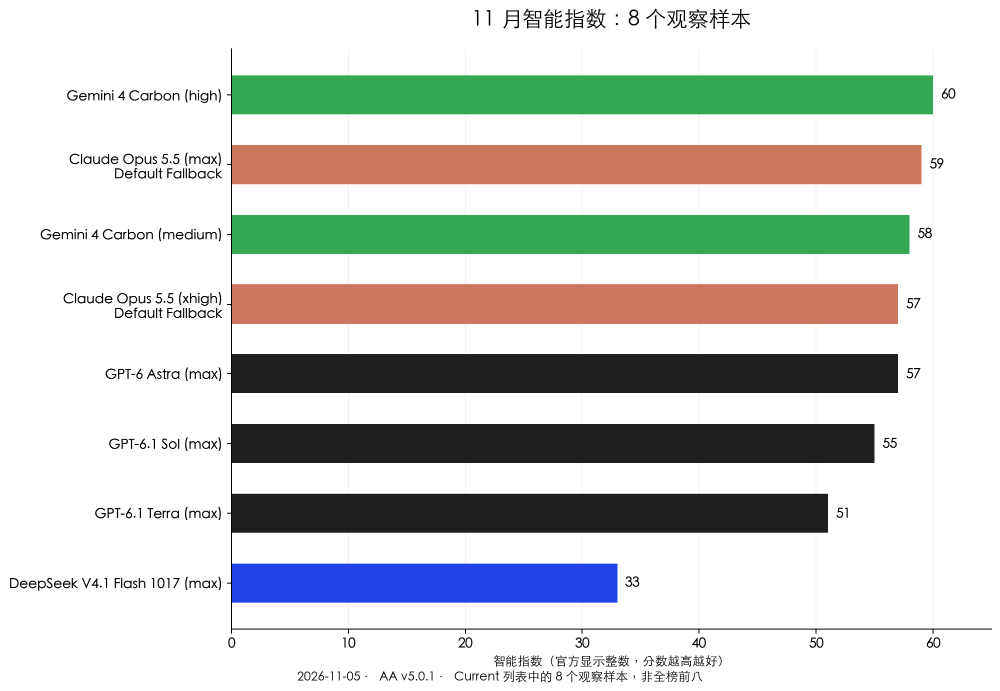
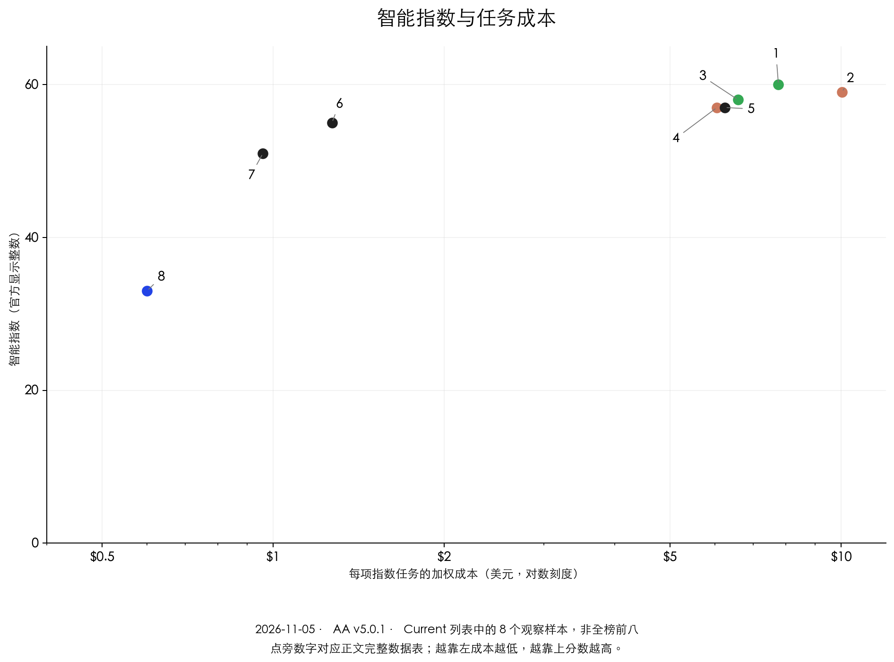

> 原载：[荒岛书生 · 原文](https://huangdaoshusheng.cn/depth/artificial-analysis-index-guide) · 作者：荒岛书生 · 原始发布日期：2026-11-05。
> 迁移核对：2026-11-07，依据当前公开正文；保留原文资料截止日期、作者观点与核验说明，不将历史资料视作今日消息。

* 目录
{:toc}

<!-- source-body:start -->
11 月这张 AI 榜单，最醒目的位置是 Gemini 4 Carbon：high 配置拿到 60 分，Claude Opus 5.5 的 max 配置为 59 分，排在后面。

但我更想把另一组数字放在一起：GPT-6 Astra 的 max 配置是 57 分，GPT-6.1 Sol 的 max 配置是 55 分。两分的差距，对应的加权单任务成本却分别是 6.24 美元和 1.27 美元，Astra 的任务成本约为 Sol 的 4.9 倍。

这也是我觉得本月榜单值得重新聊一次的原因。旗舰在抬高能力上限，另一边，接近旗舰的候选仍在改变使用成本。只看谁第一，会漏掉后一半变化。

下面采用 **2026 年 11 月 5 日的 Artificial Analysis v5.0.1 快照**，从官方 Current 列表选出 8 个配置，兼顾领先位置和成本比较。它们不是全榜前八，图中的展示序号也不是总榜名次。

## Gemini 领跑，Claude 仍在最前排

先看分数。模型后面的 high、max、xhigh，以及 Claude 的 Default Fallback，都属于评测配置的一部分。

<!-- migrated-chart:aa-intelligence-2026-11-05:start -->

*11 月智能指数：8 个观察样本。点击查看原图。2026-11-05 · Artificial Analysis v5.0.1；8 个 Current 样本，非全榜前八。*

| 图中序号 | 模型配置 | 配置说明 | 智能指数（显示整数） | 加权成本（美元/任务） |
| --- | --- | --- | ---: | ---: |
| 1 | Gemini 4 Carbon (high) | — | 60 | 7.76 |
| 2 | Claude Opus 5.5 (max) | Default Fallback | 59 | 10.04 |
| 3 | Gemini 4 Carbon (medium) | — | 58 | 6.59 |
| 4 | Claude Opus 5.5 (xhigh) | Default Fallback | 57 | 6.05 |
| 5 | GPT-6 Astra (max) | — | 57 | 6.24 |
| 6 | GPT-6.1 Sol (max) | — | 55 | 1.27 |
| 7 | GPT-6.1 Terra (max) | — | 51 | 0.96 |
| 8 | DeepSeek V4.1 Flash 1017 (max) | — | 33 | 0.60 |

[来源：Artificial Analysis Current 列表](https://artificialanalysis.ai/leaderboards/models) · [本次历史快照完整数据](/assets/data/huangdao/aa-november-2026.json)。成本不是每百万 token 单价；图中展示序号不代表总榜名次。
<!-- migrated-chart:aa-intelligence-2026-11-05:end -->

Carbon 的 high 和 medium 配置都在前面，Opus 5.5 的两个配置也进入了这组领先样本。这里有个很容易忽略的细节：同一个模型换个思考档位，分数和任务成本都会变。不能只记下产品名字，再把一个配置的结果套给所有用法。

这张图保留了来源里的品牌色，分数沿用页面显示的整数。两个条目同为 57 分，不表示原始小数完全一致；图表也没有把分差换算成“能力提高了多少百分比”。

**这次榜单还有一个比名次更重要的变化：试卷已经换了。** 10 月旧文章采用 v4.3.2，现在是 v5.0.1。v5 更新了评测组合，把知识工作、编程、科学和通用能力分别设为 25%。因此，不能拿旧图里的分数减去新图里的分数，就说某个模型退步了。

对读者来说，更稳妥的比较是在同一份快照、同一个版本里，先找到候选，再看它们在哪类任务上拉开距离。

## Sol 和 Astra 差两分，任务成本差得更多

把分数放到成本旁边，这组配置更有看头。

<!-- migrated-chart:aa-cost-2026-11-05:start -->

*智能指数与每项任务加权成本（美元，对数刻度）。点击查看原图。2026-11-05 · Artificial Analysis v5.0.1；8 个 Current 样本，非全榜前八。*

| 图中序号 | 模型配置 | 配置说明 | 智能指数（显示整数） | 加权成本（美元/任务） |
| --- | --- | --- | ---: | ---: |
| 1 | Gemini 4 Carbon (high) | — | 60 | 7.76 |
| 2 | Claude Opus 5.5 (max) | Default Fallback | 59 | 10.04 |
| 3 | Gemini 4 Carbon (medium) | — | 58 | 6.59 |
| 4 | Claude Opus 5.5 (xhigh) | Default Fallback | 57 | 6.05 |
| 5 | GPT-6 Astra (max) | — | 57 | 6.24 |
| 6 | GPT-6.1 Sol (max) | — | 55 | 1.27 |
| 7 | GPT-6.1 Terra (max) | — | 51 | 0.96 |
| 8 | DeepSeek V4.1 Flash 1017 (max) | — | 33 | 0.60 |

[来源：Artificial Analysis Current 列表](https://artificialanalysis.ai/leaderboards/models) · [本次历史快照完整数据](/assets/data/huangdao/aa-november-2026.json)。成本不是每百万 token 单价；图中展示序号不代表总榜名次。
<!-- migrated-chart:aa-cost-2026-11-05:end -->

Sol 的 max 配置位于 Astra 左边，综合分数只差两分。这意味着，在这套任务和计费口径下，它用较低成本取得了接近 Astra 的总分。对需要反复改稿、整理资料、处理重复代码的人来说，这样的候选值得认真试一次。

不过，两分不是一张“可以完全替代”的通行证。有些任务只需要稳定处理固定结构，有些任务的难点则集中在少数关键判断上。总分接近，仍可能在某道难题上表现不同。

Terra 的 max 配置也很值得放进观察名单：51 分，对应 0.96 美元的加权单任务成本。它和 Sol、Astra 组成了一个更具体的选择问题：你愿意为哪些难题支付更高成本，又有哪些工作可以交给便宜一些的候选。

我的倾向是先把重复任务与关键判断分开。重复任务要看能否稳定完成，关键判断则要看错误是否容易发现。便宜模型若需要大量人工重做，节省的 API 费用很容易被返工吃掉；昂贵模型若只是处理格式整理，也未必划算。

## DeepSeek 的热度，不能只用一个总分解释

这次选入的 DeepSeek V4.1 Flash 1017 max 配置显示 33 分。它与前排的差距，在这套综合指数里是真实存在的，不应该为了讨论热度就绕过去。

但它也不能被直接翻译成“写代码就只能做到前排的一半”。综合指数把多类任务合在一起，单项能力、中文使用、开放权重和部署条件仍会影响选择。对于想在自己的基础设施里使用模型的人，能否拿到权重、工具链是否兼容，本来就是与总分并行的问题。

10 月 17 日版本值得重看，可以继续沿着它的编程、Agent 与工具文档读下去。评价新版本时，最好把厂商公布的单项评测、第三方综合指数和自己的实际任务分开，避免几种分数相互替代。

## 单价低，和把一件事做便宜，仍是两回事

图里的美元金额是完成指数任务的加权成本，不是每百万 token 的单价，更不是一次聊天或一个完整项目的报价。实际使用还会受到输入长度、推理输出、缓存和失败重试影响。

成本图的横轴用了对数刻度，相同距离表示倍数变化。图中只画这 8 个样本，没有据此补出全榜的帕累托前沿，也没有把未取得的数据估成精确价格。

同样，“每项任务便宜”与“任务结束得快”也不是同一件事。需要频繁等待结果的工作，应把耗时一起考虑；批量处理则可能更关心总费用和人工返工。把自己的时间算进去，才接近真正的使用成本。

## 这个月，我会怎样挑候选

如果重点是综合难题，我会先看 Carbon、Opus 这类领先配置；如果是大量重复工作，会把 Sol、Terra 放进同一组真实任务；如果需要开放权重和部署控制，则单独比较相应候选。

选择不必一开始就变成复杂的模型路由。拿几项常做的工作，保留输入、结果、返工原因和总耗时，通常已经能看出哪些差别对自己重要。

**11 月这张榜给我的判断是：能力上限还在提高，成本差距也没有消失。** 谁第一值得看，谁能以合适的成本接住你的工作，同样值得看。月份更新之后，真正该一起更新的，是候选名单和自己的使用判断。

*本文为榜单点评，依据上述日期的公开快照；模型可用性与实际入口权限以对应产品为准。*

## 资料来源

- [Artificial Analysis：当前模型与任务成本列表](https://artificialanalysis.ai/leaderboards/models)
- [Artificial Analysis：智能指数 v5.0.1](https://artificialanalysis.ai/evaluations/artificial-analysis-intelligence-index)
- [Artificial Analysis：v5 更新说明](https://artificialanalysis.ai/articles/artificial-analysis-intelligence-index-v5)
- [Artificial Analysis：评测方法与版本记录](https://artificialanalysis.ai/methodology/intelligence-benchmarking)
<!-- source-body:end -->
